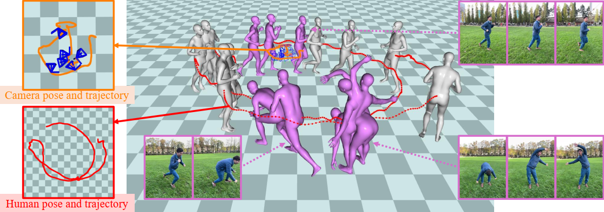

<div align="center">
<h1>WATCH: World-aware Allied Trajectory and pose reconstruction for Camera and Human</h1>

<a href="" target="_blank" rel="noopener noreferrer">
  
</a>
<a href="https://pytorch.org/get-started/locally/"></a>

**[Anonymous Institute]()**, **[Anonymous Company]()**

[Anonymous Author](), [Anonymous Author](), [Anonymous Author]()*


</div>

```bibtex
@article{watch2025,
  title={WATCH: World-aware Allied Trajectory and pose reconstruction for Camera and Human},
  author={Anonymous Author},
  journal={},
  year={2025}
}
```

## Install

- **Environment setup**: We use the same environment as [GVHMR](https://github.com/zju3dv/GVHMR).
If you want to use moving camera video as input, you can use any monocular SLAM method (e.g. DPVO, VGGT).
We would provide a detailed SLAM usage document.
- **Dependent prepare**: Like GVHMR, you should put our dependent files to folder `.\inputs\ `.
The folder format is:
```
WATCH
├── assets/               # assests for this git project
├── core/                 # core codes for our WATCH
├── inputs/
│   ├── 3DPW/             # Benchmark datasets for training and evaluation
│   ├── AMASS/
│   ├── BEDLAM/
│   ├── EMDB/
│   ├── H36M/
│   ├── RICH/
│   └── checkpoints/
│       ├── body_models/  # smpl and smplx pkl
│       ├── dpvo/         # checkpoints for DPVO 
│       ├── hmr2/         # checkpoints for HMR2.0 (4DHuman)
│       ├── vitpose/      # checkpoitns for ViTPose
│       ├── yolo/         # checkpoints for YoLo
│       └── watch/        # checkpoints for our WATCH model
├── outputs/              # result folder
├── scripts/              # Main scripts for training, evaluation and demo inference
├── third-party/          # DPVO required. If you don't use SLAM, it can be empty
```

## Docker
We provide a close source docker.

Dockerfile coming soon.

## Demo
If you want to use watch for video mocap inference, you can run the following scripts:

```bash
python scripts/demo/watch_demo.py -s
```

```bash
python scripts/demo/watch_demo_folder.py -f demo/inputs/20250808_wan22 -d outputs/demo_watch/20250808_wan22 -s
```

Note: Please append `-v` or `--verbose` to draw bbox and 2d kp to check intermediate parameters.
Example:
```bash
python scripts/demo/watch_demo_folder.py -f demo/inputs/20250808_wan22 -d outputs/demo_watch/20250808_wan22 -s -v
```

## TODO
- [x] WATCH project prepare
- [x] Demo scripts refine
- [x] Project page release to git.woa.com
- [ ] Project page release
- [ ] Code framework reform
- [ ] Arxiv paper publish
- [ ] Evaluation scripts release
- [ ] Training scripts release

## Acknowledge
Code largely borrowed from [GVHMR](https://github.com/zju3dv/GVHMR).

## Licences
This repository is released under the MIT License.

## Contact
Please contact [Qijun Ying](yqj@mail.ustc.edu.cn) and [Zhongyuan Hu](huzhongyyuan@gmail.com)
for any questions related to this work.
